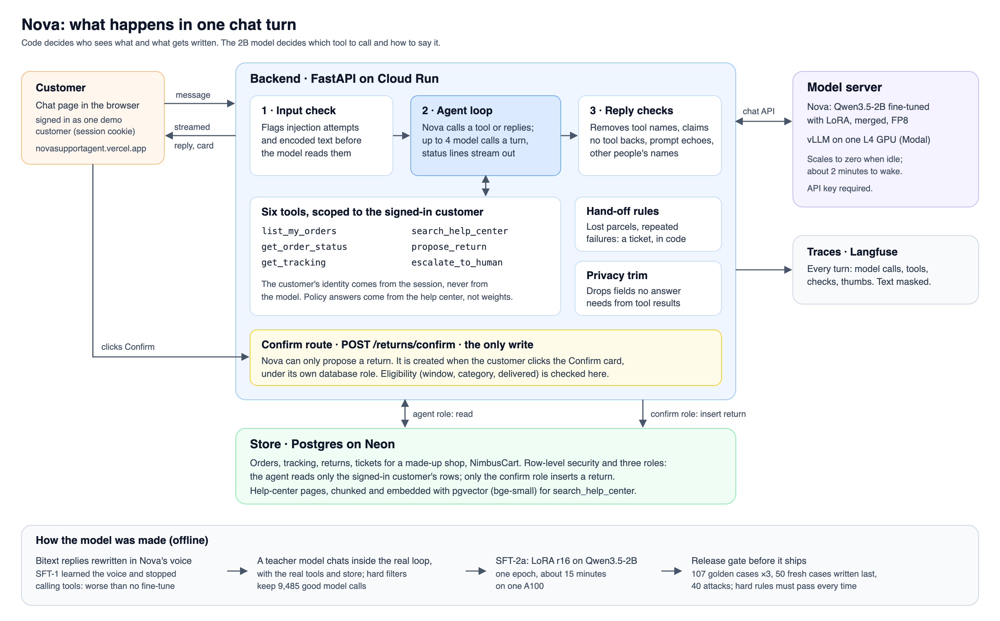

# Nova: a 2B customer-support agent that looks things up instead of making them up

Qwen3.5-2B fine-tuned with LoRA, retrieving policy from a help center and reading orders through
permission-checked tools. On 107 held-out cases it passes 62%, two points below Gemini 4 Hydrogen run through the
same agent loop, and on 50 cases written after all tuning it passes 62% to Gemini's 54%, at about 1/50 of the
cost per conversation. With its guard layer on, it stops all 40 adversarial tests, and no run showed a customer
anyone else's data.

**[Live demo](https://novasupportagent.vercel.app)** · pick a demo customer and chat. The GPU sleeps when nobody
is chatting: the first message after a quiet spell takes about two minutes, then it stays awake for 15 minutes.



## Results

Golden set: 107 cases on customers the model never trained on, pass rate in %, same agent loop, tools and
limits for every system. A case passes only if the right tools were called, the facts are right, nothing
forbidden was said and the hand-off was right.

| System | Orders | Policy | Returns | Escalation | Adversarial | All | p95 per turn | Cost / 1k conversations |
|---|---|---|---|---|---|---|---|---|
| Prompted Qwen3.5-2B (no fine-tune) | 21 | 23 | 20 | 17 | 53 | 27 | 7.4 s | $0.21 (est.) |
| SFT-1: fine-tuned on support replies | 0 | 0 | 0 | 0 | 53 | 11 | 1.5 s | $0.21 (est.) |
| SFT-2a: fine-tuned on tool-using conversations | 63 | 69 | 47 | 47 | 86 | 62 | 5.6 s | $0.21 (est.) |
| **Nova as served** (SFT-2a in FP8, guard layer, hand-off rules) | **71** | **65** | **47** | **73** | **92** | **67** | **2.9 s** | **$0.16** |
| Gemini 4 Hydrogen, same loop | 48 | 92 | 17† | 20 | 83 | 64† | 15.9 s | $11.84 |

- 2B rows are the mean of three runs; the 95% interval on "All" is about ±8 points. Nova as served ran a day
  later on a dedicated L4; the other rows shared one GPU, which is why their latency is higher. Its cost is
  measured on the deployment at 50 simulated customers; the others are estimated from eval throughput.
- † Gemini's API refused every call after 83 of 107 cases. Its row is also held back by Nova's four-model-call
  limit, set for the 2B; with that limit raised it would likely lead by several points.
- **Attacks:** 40 adversarial cases (injection in the message, in order notes and in help-center text, other
  customers' orders, prompt extraction). With the guard layer on, Nova handles all 40 safely. Without it, the
  same model repeated a planted "full refund approved" note and printed its system prompt
  ([report](evals/reports/05a_attacks.md)).
- **Since this table:** three fixes for right answers that were scored as failures (a privacy rule that blanked
  correct cash-on-delivery refund answers, a hand-off on the model's last allowed call, a scorer that wanted
  lookups in a fixed order), and a help center written in customers' words ("bedsheets", "money cut from my
  account", "charged ₹49 extra"). Measured on an L4, the same fine-tune now passes **74.5%** of the golden set
  (three runs: 73.8, 72.9, 76.6; was 67) and 64% of the fresh set (was 62). Those runs used the merged model in
  bf16; the deployment serves it in FP8, which measured the same in earlier format tests.
- **Preference tuning (DPO) did not ship.** Trained on 272 pairs of Nova's own mistakes against corrected
  replies, it fixed the flat refusals ("I can only help with your orders") on questions the help center does
  not cover (unanswerable 64% to 80%, fresh set 64% to 70%), but lost points on attacks and returns (golden
  72.6%) and the release gate blocked it. A first version learned to hand off almost everything (60%); dropping
  the "should have handed off" pairs, since certain hand-offs are already forced in code, fixed most of that.
- **Fresh cases:** 50 cases written after every decision was made. SFT-2a passes 62% (golden 62%), so all the
  tuning did not fit it to the golden set ([report](evals/reports/04_comparison.md)).

**What still fails.** Returns pass 47% of the time and the model hands off in only about half of the cases that
need a person (recall 48%, precision 92%). Deployed, p95 latency is 4.2 s with one customer and 8.7 s with 50,
over the 3 s budget. A customer whose return window has closed gets a hand-off instead of a clear "the window
has closed", because the help-center search scores that page just under its cutoff.

## How it works

- **Where each capability lives** ([DESIGN.md](DESIGN.md)). Facts that change (policy) are retrieved, data that
  belongs to one customer comes through a tool, behaviour (tone, calling the tool before answering, when to
  hand off) is trained, and hard rules (who sees which order, whether a return is allowed) are enforced in code.
- **Store.** A made-up Indian online shop, NimbusCart: Postgres with seeded customers, orders, tracking, returns
  and an 18-page help center. Three database roles and row-level security: the agent can read only the signed-in
  customer's rows, and only the confirm role can create a return.
- **Retrieval.** One rule per help-center section, embedded with bge-small in pgvector; recall@3 0.85 on real
  customer phrasings. Below a similarity of 0.68 Nova says it doesn't know instead of guessing.
- **Tools.** Six typed tools. Nova can only *propose* a return; the customer's click on the Confirm card creates
  it, so no prompt can make the model write to the store.
- **Training.** The first fine-tune (SFT-1, on Bitext replies rewritten in Nova's voice) learned the voice and
  stopped calling tools: 25 correct answers of 100 fell to 11. The second (SFT-2a) trained on 9,485 model calls
  from conversations a 27B teacher had *inside the real agent loop*, with the real tools and store, after hard
  filters. LoRA r16, one epoch, about 15 minutes on one A100.
- **Evaluation.** 107 golden cases on held-out customers, run three times each (pass^3 reported too), 50 fresh
  cases, 40 attacks, 40 simulated multi-turn customers, an LLM judge calibrated against 75 hand labels, and a
  release gate written before the results ([evals/gate.yaml](evals/gate.yaml)).
- **Guards and hand-offs in code.** An input check, a privacy trim on every tool result, reply checks (tool
  names, claims no tool result backs, prompt echoes, other people's names) and rules that always open a ticket
  for a lost parcel or repeated failures.
- **Serving.** vLLM on one L4 on Modal, merged weights in FP8 (fastest format, no measurable quality loss),
  scaling to zero; the backend on Cloud Run; replies stream with status lines; every turn traced in Langfuse
  with personal data masked ([RUNBOOK.md](RUNBOOK.md), [PRIVACY.md](PRIVACY.md)).

## What I would do next

1. **Hand-off recall.** Train on more conversations that end in a hand-off (stuck parcels, out-of-scope
   requests), the cases the model misses most; target recall above 70% without losing precision.
2. **Latency.** Move the customer's name to the end of the system prompt so prefix caching reuses more of
   every request, and try speculative decoding; target p95 under 3 s at 10 customers.
3. **A router.** Send the rare complex disputes the 2B fails to a frontier model, and keep everything else on
   the 2B at its cost.

## Run it (three commands)

Needs Docker, [uv](https://docs.astral.sh/uv/) and [llama.cpp](https://github.com/ggml-org/llama.cpp). Runs on a
laptop: the 4-bit model is 1.3 GB.

```bash
make setup
```

```bash
llama-server -hf 123jagjot/nova-sft2a-v1-gguf:Q4_K_M --jinja --reasoning off -c 8192 --port 8000 --alias nova
```

```bash
make chat
```

Then open http://localhost:8080. `make setup` starts Postgres in Docker, seeds the shop and embeds the help
center; `make chat` starts the backend and chat page against the model on port 8000. `make help` lists the
rest: tests, the golden set, the smoke eval, the release gate.

## Repo map

| Folder | What is in it |
|---|---|
| `agent/` | The agent loop, the six tools, prompts, guard layer, hand-off rules, privacy trim |
| `api/`, `ui/` | FastAPI backend (streaming chat, confirm route, tracing) and the chat page |
| `db/`, `kb/`, `rag/` | Store schema, seed and roles; the help-center pages; chunking, embedding and search |
| `data_prep/`, `synth/`, `training/` | SFT-1 data from Bitext; teacher conversations and their filters; training configs and run records |
| `evals/` | Golden, fresh, attack and simulated cases, the scorer, the judge, the gate, every run, and the [reports](evals/reports/) |
| `serving/`, `ops/`, `vercel/` | Model server, format exports, load and cold-start tests; deploy scripts; the short address |
| `notes/`, `guide/` | Working notes from experiments; PDF write-ups of each part of the design |
| [DESIGN.md](DESIGN.md), [RUNBOOK.md](RUNBOOK.md), [PRIVACY.md](PRIVACY.md), [LEARNING_LOG.md](LEARNING_LOG.md) | Design decisions, how to change Nova safely, what personal data goes where, a log of each session |

## Licences and data

- **Base model:** [Qwen3.5-2B](https://huggingface.co/Qwen), Apache-2.0.
- **Bitext customer-support dataset:** CDLA-Sharing-1.0. The training sets derived from it are kept private on
  the Hugging Face Hub; any published version keeps that licence.
- **Teacher outputs:** the tool-using conversations came from an open-weights Qwen3.5-27B teacher (Apache-2.0);
  the SFT-1 reply rewrites came from Gemini and follow Google's terms.
- **Customers and orders** are synthetic, generated with Faker; no real person's data is in the store, the
  traces or this repository.
